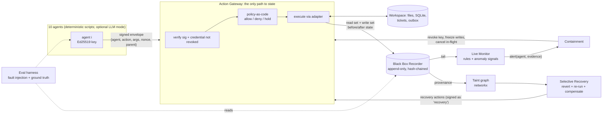

# ENG-00 Strawman architecture (for Sprint 1 to break)

Author: maya · Status: strawman, 19 Nov · Every claim here is **[Our view]** until a RES report confirms or kills it.

## 1. Components and data flow

**Identity.** Per-agent Ed25519 keypair plus a short-lived credential (id, role, scopes, expiry) from a local issuer.
Every tool call is a signed **action envelope** (`agent_id, action_id, tool, args, nonce, parent_action_id`; parent
gives delegation lineage). No shared service credentials.

**Action Gateway.** Agents hold only a gateway client, never a workspace handle. The gateway verifies signature, nonce
and revocation, evaluates policy (scopes, rate limits, holds on irreversible actions), then executes via a typed adapter
per resource. Adapters, not agents, report what was read and written. Containment bites here.

**Black Box Recorder.** One JSONL record per action: envelope, policy decision, **read set** (items + versions read),
**write set** (before/after values), reversibility class (reversible / compensable / irreversible), time. Each record
carries `prev_hash` and its SHA-256; the recorder periodically signs the chain head. Agents cannot write to it;
re-verifying the chain exposes tampering.

**Live Monitor.** Tails the recorder. Rules (deny bursts, out-of-scope writes, payment limits, bad signatures, log access)
plus anomaly signals vs. a per-agent rolling baseline (action rate, delete ratio, new resource types). Emits
`alert(agent, evidence_ids, score)`; attribution comes free because evidence is signed by the culprit.

**Containment.** On alert (auto above threshold, else one click): revoke the credential, quarantine the agent at the
gateway (further envelopes denied and recorded), cancel its queued/in-flight actions, **hold** its undispatched outbox
items. Other agents keep running.

**Selective Recovery.** Graph from the recording: action → wrote → version → read by → action. Taint = culprit's writes
after the incident start (monitor-proposed, human-adjustable) plus everything transitively derived. Then: (1) restore
before-values of tainted reversible writes; (2) re-run honest agents' tainted actions on repaired state (the Retro/Warp
idea; cheap with deterministic agents); (3) compensate compensable external effects (refund, correction email);
(4) report irreversible ones to humans. Untainted work is untouched; recovery actions go through the gateway too.

**Eval harness.** Seeds the world, runs agents on a logical clock, injects a fault, diffs against a no-fault ground-truth run.

## 2. Demo world: "Acme Mini-Co"

Shared workspace: `docs/` (markdown), SQLite (`customers`, `invoices`, `ledger`, `inventory`), ticket board, outbound
email outbox, payments outbox (dispatched every N ticks, so there is a hold window).

| Agent | Role |
|---|---|
| intake | turns inbound requests into tickets |
| triage | assigns and prioritises tickets |
| crm | maintains customer records |
| billing | creates invoices from tickets + customer data |
| payments | pays approved supplier invoices |
| inventory | updates stock, raises reorder tickets |
| reporter | builds daily KPI doc from DB |
| comms | sends customer emails from templates |
| compliance | samples ledger, files findings |
| docs | keeps the wiki/runbook current |

Deliberate dependencies (billing reads crm; reporter reads billing, inventory; comms reads billing) mean a crm fault
propagates, so "revert crm" alone is insufficient.

**Fault catalogue** (one per scenario, seeded, injected at a random tick):

| ID | Fault | Tests |
|---|---|---|
| F1 | deletes customer records | reversible revert |
| F2 | corrupts values (wrong IBAN, price ×10) that others then read | taint propagation + re-run |
| F3 | exfiltrates customer data via email outbox | irreversible, hold window |
| F4 | spams payments | compensable, rate rules |
| F5 | forges another agent's identity | signature check |
| F6 | tampers with or deletes log records | hash chain |
| F7 | slow drift (small, plausible changes) | anomaly limits; honest failure case |

**Metrics** (all computed from ground truth, so the jury can recompute them):
- **TTI**: injection → first alert naming the right agent (ticks + ms; count wrong-agent alerts).
- **TTC**: alert → culprit's last effective action.
- **Precision** = correct reverts / all reverts; **recall** = correct reverts / all bad effects; **collateral loss** =
  honest effects lost vs. ground truth; **residual damage** = bad effects left (compensated vs. irreversible).
- Baselines: full snapshot restore (high collateral); revert culprit without taint (low recall).

## 3. Riskiest assumptions

| # | Assumption | If wrong | Tested by |
|---|---|---|---|
| A1 | Read/write-set provenance + re-execution gives clean selective undo; non-determinism (LLM agents) is the hard part | LLM mode degrades to "revert + flag" | RES-01, RES-06 |
| A2 | Every effect can be classified reversible / compensable / irreversible *before* it runs, so irreversible ones can be held | Containment cannot stop external damage | RES-02 |
| A3 | Signed per-action envelopes at one chokepoint hold attribution through delegation and shared tools (MCP) | Attribution breaks at shared service credentials | RES-03 |
| A4 | OTel GenAI spans lack read/write sets, so our record is a needed extension, and a hash chain is enough tamper evidence for an audit | We duplicate existing work, or our "audit" claim is weak | RES-04, RES-08 |
| A5 | No existing tool combines agent quarantine with per-author rollback; provenance beats LLM-judge attribution on TTI | Novelty fails; reframe as "attribution + containment" | RES-05, RES-06, RES-07 |

## 4. Prototype tech choices

- Python 3.13, offline, no keys: stdlib (`sqlite3`, `hashlib`), **pydantic** (schemas), **cryptography** (Ed25519),
  **networkx** (taint graph), **pytest**. No web framework: CLI plus static HTML timeline. Single process, logical clock,
  seeded RNG: every run reproducible.
- Enterprise mapping (bank/OTel context):
  - Records export as OTel spans (`gen_ai.*` where defined, plus `ks.read_set`/`ks.write_set`) via OTLP-JSON file, ready for a collector.
  - Policy-as-code in a declarative file; swappable for OPA/Rego or Cedar.
  - Identity → SPIFFE / workload identity + OAuth token exchange; revocation = token revocation.
  - Gateway → API gateway/sidecar; hash chain → WORM storage or transparency log for regulated audit.

## 5. Open questions for Call #1

1. Headline: "selective undo" (bold, rests on A1) or "attribution + containment" (safer)? Decide after RES-SYN.
2. Auto-contain or human-in-the-loop by default; what threshold?
3. Pause readers of tainted data during recovery, or let them run and re-execute later?
4. LLM mode at the finale, or stretch goal?
5. Is an outbox hold window a fair demo assumption, or will the jury call it a cheat?
6. How does the jury "break it" live: a fault-injection CLI, or a rogue agent they script?
7. Hero scenario: F2 (propagation) tells the strongest story. Agree?
